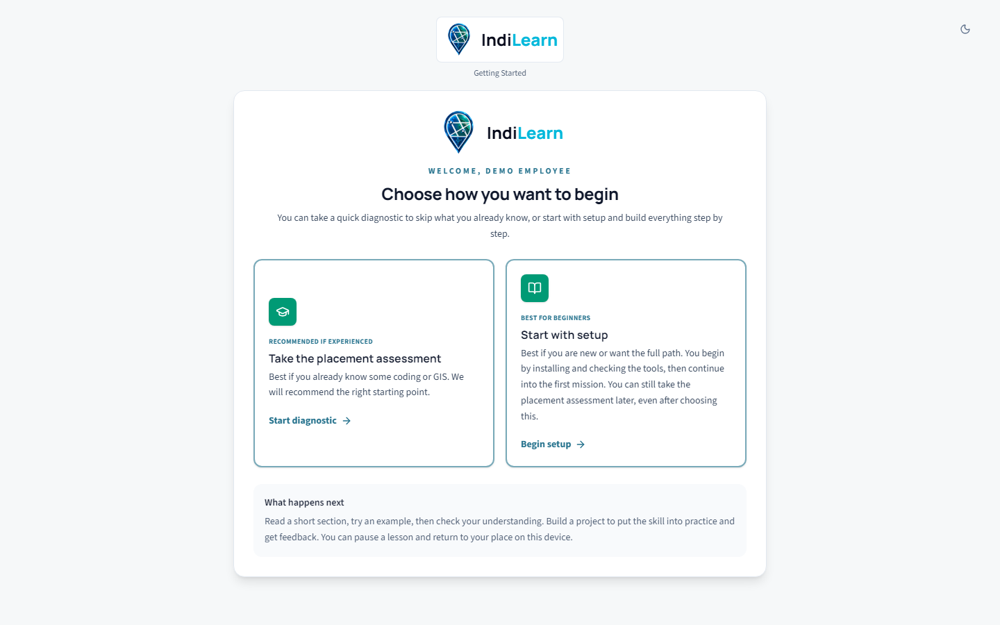
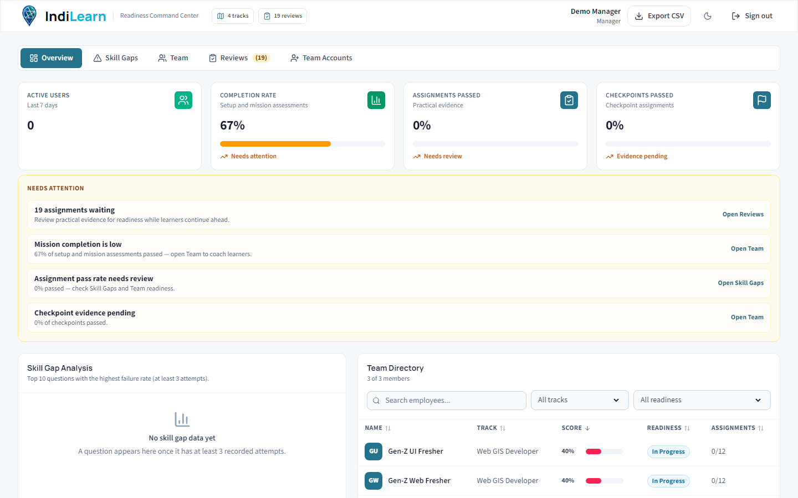

# IndiLearn

**Training that shows who is ready, based on evidence rather than time spent.**

> **Showcase page.** This page shows what the product does. The product and its source code are proprietary and are not published. See [LICENSE](LICENSE).

## What it does

IndiLearn helps technical teams bring new engineers up to speed quickly. New joiners follow a structured, hands-on programme at their own pace, and their managers can see, person by person, who is ready for real project work.

## Who it is for

| Role | What they get |
|---|---|
| **Learners** | Short lessons, practical exercises, quizzes and project work, with a placement check so experienced people can skip what they already know. |
| **Managers** | A clear view of team progress, skill gaps and readiness, plus a simple way to review submitted work. |
| **Administrators** | Control over accounts and teams, with a record of important actions. |

## Why it helps

- **Readiness you can trust.** Progress is judged on completed, reviewed work.
- **Targeted coaching.** Managers see where the team struggles most.
- **Learn anywhere.** It keeps working when the connection drops.

## Screenshots

| Getting started | Manager view |
|---|---|
|  |  |

## Status

Working application with a complete flow for learners, managers and administrators.

## Skills shown

Product design · full-stack web development · learning design · analytics dashboards · security basics

## Contact

Interested in a pilot or a licence? Message me on [LinkedIn](https://www.linkedin.com/in/abishek-f-151708222).
